# Student Document Verification Pipeline

An Azure Functions pipeline that stores employee reference and new documents, extracts fields with Azure AI Document Intelligence, combines the results, and asks a Microsoft Foundry agent to produce a verification report.

## Project layout

```text
function_app.py              Azure Functions triggers, orchestration, and activities
send_test.py                 Command-line folder uploader
shared/
  clients.py                 Azure AI client factories
  config.py                  Container, model, and output configuration
  document_processing.py     Reusable document normalization and extraction helpers
  file_validation.py         File content validation
  schemas.py                 Request and queue message schemas
  storage.py                 Blob Storage helpers
  utils.py                   Shared workflow and output helpers
tests/                       Automated tests
documents/                   Setup, API, and workflow documentation
host.json                    Azure Functions host configuration
requirements.txt             Python dependencies
```

## Project flow

```mermaid
flowchart LR
    Client([Client]) --> Upload[POST /api/upload<br/>employee ID, run kind, Base64 files]
    Upload --> Decode[Decode HTTP Base64 once]
    Decode --> Stage[(Temporary binary Blob staging)]
    Stage --> Queue[Send run metadata and blob paths<br/>to Service Bus]

    Queue --> Trigger[Service Bus trigger]
    Trigger --> Orchestrator[Start Durable Functions<br/>orchestration]
    Orchestrator --> Branch{Run kind?}

    Branch -->|baseline| BaselineFiles[Process uploaded baseline files]
    Branch -->|verification| VerificationFiles[Process uploaded verification files]
    BaselineFiles --> Work[Process files in parallel]
    VerificationFiles --> Work

    Work --> DecodeLegacy[Decode legacy Base64 .txt files<br/>when present]
    DecodeLegacy --> Normalize[Normalize images in memory<br/>PDFs pass through]
    Normalize --> Extract[Classify and extract fields<br/>with Document Intelligence]
    Extract --> Combine[Combine extraction results<br/>and record per-file errors]
    Combine --> Json[(Save combined.json<br/>to results/ and local output)]
    Json --> Cleanup[Delete staged source files]

    Cleanup --> Verify{Verification run?}
    Verify -->|No: baseline| DoneBaseline([Baseline run complete])
    Verify -->|Yes| Foundry[Send previous and new fields<br/>to Microsoft Foundry agent]
    Foundry --> Report[Save verification_report.txt<br/>to local output]
    Report --> DoneVerification([Verification run complete])

    Client -. GET /api/status/{employee_id}/{run_id} .-> Status[Read Durable Functions<br/>run status and output]
```



Editable Excalidraw version: [project-flow.excalidraw](project-flow.excalidraw).

The API decodes the HTTP Base64 once and temporarily stores the original binary bytes in `processing-staging`. The queue carries blob paths only. After extraction results are saved, the pipeline deletes the staged source files; a Blob lifecycle rule is the fallback for abandoned runs. Lifecycle cleanup is delayed, and Blob soft delete can retain deleted files for its configured recovery period. Normalized image bytes are held in memory and are not uploaded. A `.txt` file is treated as a legacy Base64 source and decoded by the worker.

## Azure resources

Provision these resources in the same environment or provide their connection details:

| Resource | Purpose / configuration |
| --- | --- |
| Azure Storage account | Functions host and Durable Functions state (`AzureWebJobsStorage`); document/result blobs (`StorageConnection`). Use a general-purpose account supporting Blob, Queue, and Table services. |
| Blob containers | `processing-staging` for temporary source files and `results` for combined extracted JSON. The app creates missing containers when needed. Apply the [seven-day staging lifecycle rule](documents/staging-lifecycle-policy.json) as a fallback, merging it with existing storage-account rules. |
| Azure Service Bus namespace and queue | Create the `document-processing` queue. Configure an identity-based `ServiceBusConnection` and grant the Function identity Service Bus Data Sender and Data Receiver roles on the queue. |
| Azure AI Document Intelligence | Provide its endpoint and key. Built-in models used are `prebuilt-idDocument`, `prebuilt-invoice`, and `prebuilt-layout`. An optional custom classifier can be configured with `DI_CLASSIFIER_ID`. |
| Microsoft Foundry project and agent | Create/configure the agent and provide its project endpoint and agent name. The agent receives extracted JSON fields for baseline and verification documents. `FOUNDRY_AGENT_VERSION` is optional. |
| Azure Function App | Python v2 programming model, Functions runtime v4, and the dependencies in `requirements.txt`. Configure the settings below in the Function App. |

For local development, the code uses `DefaultAzureCredential`; run `az login` and grant the signed-in identity permission to interact with the agent endpoint and the Service Bus queue. The Function App should use its managed identity in Azure. Grant the Foundry identity **Foundry Agent Consumer** and grant the Service Bus identity **Azure Service Bus Data Sender** and **Azure Service Bus Data Receiver** at the narrowest practical scope. See Microsoft's [Foundry RBAC guidance](https://learn.microsoft.com/azure/ai-foundry/concepts/rbac-ai-foundry) and [Service Bus identity guidance](https://learn.microsoft.com/azure/azure-functions/functions-bindings-service-bus).

The setup notes in [`documents/SETUP.md`](documents/SETUP.md) list a storage account and resource group used earlier in this project. Confirm those resources still exist and use the matching connection strings before running the app.

## Configuration

Set these values in `local.settings.json` under `Values` for local development, or as Function App application settings after deployment:

| Setting | Required | Description |
| --- | --- | --- |
| `FUNCTIONS_WORKER_RUNTIME` | Yes | Set to `python`. |
| `AzureWebJobsStorage` | Yes | Storage connection used by the Functions host and Durable Functions. |
| `StorageConnection` | Yes | Storage connection used for source documents and combined results. Can be the same account as `AzureWebJobsStorage`. |
| `ServiceBusConnection__fullyQualifiedNamespace` | Yes | Service Bus namespace hostname for identity-based queue access, for example `my-namespace.servicebus.windows.net`. The local developer identity or Function App managed identity needs Data Sender and Data Receiver access. Do not put a Service Bus key in app settings. |
| `DI_ENDPOINT` | Yes | Document Intelligence endpoint URL. |
| `DI_KEY` | Yes | Document Intelligence key. |
| `FOUNDRY_PROJECT_ENDPOINT` | Yes for verification | Microsoft Foundry project endpoint. |
| `FOUNDRY_AGENT_NAME` | Yes for verification | Name of the configured Foundry agent. |
| `FOUNDRY_AGENT_VERSION` | No | Specific agent version, if needed. |
| `DI_CLASSIFIER_ID` | No | Document Intelligence custom classifier ID. Without it, the app uses layout OCR and keyword scoring to classify documents. |
| `LOCAL_OUTPUT_DIR` | No | Local output directory. Defaults to `local_results` beside `function_app.py`. |

Example shape (replace placeholders locally; never commit secrets):

```json
{
  "IsEncrypted": false,
  "Values": {
    "FUNCTIONS_WORKER_RUNTIME": "python",
    "AzureWebJobsStorage": "<storage connection string>",
    "StorageConnection": "<storage connection string>",
    "ServiceBusConnection__fullyQualifiedNamespace": "<namespace>.servicebus.windows.net",
    "DI_ENDPOINT": "https://<document-intelligence-resource>.cognitiveservices.azure.com/",
    "DI_KEY": "<document-intelligence key>",
    "FOUNDRY_PROJECT_ENDPOINT": "https://<foundry-project-endpoint>",
    "FOUNDRY_AGENT_NAME": "<agent name>"
  }
}
```

`local.settings.json` contains secrets and should remain untracked. Use the sanitized `local.settings.json.example` as a reference, and add the Foundry values shown above when running verification locally. For Service Bus, `az login` supplies the local identity; grant that identity Sender and Receiver roles. In Azure, enable a Function App managed identity and grant those roles to it. Avoid SAS connection strings; after all clients use Microsoft Entra authentication, disable local/SAS authentication on the namespace.

## Local setup

Prerequisites: Python 3.14, Azure Functions Core Tools v4, Azure CLI, and access to the Azure resources above. Python 3.14 is currently GA for Azure Functions; hosting-plan support can vary, so match the runtime version to the chosen plan. See [supported Azure Functions languages](https://learn.microsoft.com/azure/azure-functions/supported-languages).

From the project directory in PowerShell:

```powershell
py -3.14 -m venv .venv
.\.venv\Scripts\Activate.ps1
python -m pip install --upgrade pip
pip install -r requirements.txt
az login
func start
```

Create `local.settings.json` from `local.settings.json.example`, then fill in the required settings. `func start` starts the HTTP endpoints and listens to the configured Service Bus queue; leave it running while exercising the pipeline.

## API

### Upload and queue a run

`POST /api/upload` (Function authorization; local Functions Core Tools may allow calls without a key):

```json
{
  "employee_id": "emp123",
  "kind": "verification",
  "files": [
    {
      "file_name": "AdharCard.jpg",
      "file_base64": "<Base64-encoded binary file bytes>",
      "doc_type": "auto"
    }
  ]
}
```

`kind` must be `baseline` or `verification`; it determines how extracted fields are combined. `doc_type` is an optional classification hint (`auto`, `id`, `invoice`, or `ssc_memo`). The endpoint decodes the HTTP Base64 once, stages the binary file in `processing-staging`, and returns HTTP `202` with a `run_id` after queueing. Content validation happens in the worker, so an invalid document can still be queued and then reported as a per-file error. The client should Base64-encode the original bytes and pass a filename with its actual extension.

The upload request is validated with Pydantic for employee ID, filename, supported extension, Base64 syntax, and `doc_type`. Empty Base64 is allowed so a zero-byte file can reach the worker and become an `empty_file` result. Malformed transport Base64 and invalid request fields return HTTP `400`; document-content errors are recorded asynchronously. Service Bus messages and status-route parameters are validated again before use.

## Error handling for blank and corrupt files

The worker validates each staged file after it is downloaded. One bad document does not prevent other files in the run from being processed. Legacy `.txt` files are decoded as Base64 and checked by the same worker validation.

| Code | Meaning | Retried? | Where detected |
| --- | --- | --- | --- |
| `empty_file` | Empty file or whitespace-only `.txt` | No | Processing |
| `invalid_base64` | Legacy `.txt` is not Base64 | No | Processing |
| `unsupported_file_type` | Signature is unsupported or invalid | No | Processing |
| `extension_mismatch` | Extension differs from detected content; accepted with warning | No | Processing |
| `corrupt_image` | Image cannot be fully read | No | Processing |
| `corrupt_pdf` | PDF structure is invalid or has no pages | No | Processing |
| `password_protected_pdf` | PDF cannot be opened without a password | No | Processing |
| `blank_document` | Image is nearly uniform or PDF has no text/images | No | Processing |
| `file_too_large` | File exceeds configured size limit | No | Processing |
| `transient_service_error` | A temporary service/network error remained after retries | Already retried | Durable run |

Content validation errors appear in the completed run output and are stored in the `errors` section of `combined.json`:

```json
{"status":"all_files_failed","errors":[{"file":"emp123/auto/<run-id>/a.jpg","error_code":"corrupt_image","error":"Image could not be read."}]}
```

When a verification run has both readable and unreadable files, its report includes an `UNPROCESSABLE FILES` heading. Those files are identified there and must not be treated as missing or mismatched. `send_test.py` sends supported files to the API without local content validation; the worker records the file-level result. If all uploaded files fail processing, Foundry is skipped and the run status is `all_files_failed`; previously stored extraction results are retained.

Example optional upload field:

```json
"skipped_files": [
  {"file_name": "Blankocrtest.pdf.base64.txt", "error_code": "blank_document"}
]
```

| Setting | Default | Description |
| --- | --- | --- |
| `MAX_FILE_BYTES` | `20971520` (20 MiB) | Maximum accepted file size, checked by the processing worker. |
| `BLANK_IMAGE_STDDEV_THRESHOLD` | `2.0` | Grayscale standard deviation below which an image is considered blank. Raise this for fewer blank detections on faint scans. |

Troubleshooting: `unsupported_file_type` usually means the extension or file contents are wrong; `corrupt_image`/`corrupt_pdf` means the file is truncated or unreadable; `password_protected_pdf` requires an unlocked PDF; `blank_document` means the scan has too little visible content; `file_too_large` can be fixed by reducing the file size or changing `MAX_FILE_BYTES`. A `transient_service_error` points to DI, Blob Storage, network, or timeout issues; check service health and connectivity before rerunning.

### Check run status

```text
GET /api/status/{employee_id}/{run_id}
```

The response contains the Durable Functions runtime state and output. A run can return `no_files_found` if its queue message contains no supported file paths.

## Processing and output details

- Supported extensions are PDF, JPG/JPEG, PNG, BMP, TIFF, WEBP, and legacy Base64 `.txt` blobs.
- Image rotation/orientation and resizing are normalized in memory. PDFs pass through unchanged.
- Documents with `id` or `invoice` hints use their corresponding prebuilt extraction models. Other documents use layout OCR; classification uses the optional configured classifier or keyword scoring.
- A verification run processes only the verification files from that upload and compares them with baseline fields already saved in `results/{employee_id}/combined.json`.
- Source files are deleted from `processing-staging` after the extraction results are saved. A lifecycle rule provides delayed cleanup if a run fails before its cleanup activity.
- Combined extraction is written to Blob Storage at `results/{employee_id}/combined.json` and locally at `{LOCAL_OUTPUT_DIR}/{employee_id}/combined.json`. Each successful document entry includes `document_type`, `file_name`, `source_file`, and `fields`; failures are recorded under `errors`.
- `document_type` is inferred from OCR text, with the filename as a fallback (for example, Aadhaar Card, PAN Card, or Driving Licence). The Foundry request gets the display filename only, not the Blob path, and is instructed to show both `document_type` and `file_name` under `DOCUMENTS REVIEWED`. Its formatted report is saved only locally at `{LOCAL_OUTPUT_DIR}/{employee_id}/verification_report.txt`.
- Baseline-only runs process the uploaded baseline files and update the baseline section of the combined JSON. Foundry is called for verification runs.
- Each upload receives a full 32-character UUID `run_id`; the Durable instance ID combines it with the employee ID. A redelivered Service Bus message for an existing instance is ignored, preventing duplicate orchestration starts.
- Each employee upload is a separate queue message and orchestration. If five employees are submitted separately and one run fails, the other four continue. A failed document is logged with its employee ID, run ID, file, and exception; its reason is also stored in the `errors` section of `combined.json`. A run-level storage or Foundry failure is logged and marks only that employee's orchestration as failed.
- Service Bus messages contain employee/run metadata and Blob paths, not the document bytes or Base64 payload.

## Troubleshooting

- **`no_files_found`:** Check that the upload contains files with supported extensions. Legacy `.txt` files need valid inner Base64 that decodes to a supported file type.
- **Base64 decode/file signature error:** Verify that the `.txt` content contains Base64-encoded binary bytes, not plain OCR text, and that the decoded file is PDF or a supported image.
- **Service Bus trigger does not run:** Confirm the `document-processing` queue exists, `ServiceBusConnection__fullyQualifiedNamespace` names the namespace, and the active identity has the Data Sender and Data Receiver roles. Local development uses the identity from `az login`; Azure uses the Function App managed identity.
- **Durable Functions storage errors:** Check `AzureWebJobsStorage` connectivity and permissions. This is separate from `StorageConnection` if the app uses two storage accounts.
- **Foundry authorization error:** Confirm `az login` is using the intended identity locally, or that the Function App managed identity has Foundry agent endpoint access. Check the endpoint and agent name/version settings.
- **Foundry 409, response already in progress:** Verification runs use separate short-lived conversations. If this persists, check whether an earlier Foundry response is still running, then retry with a new verification run.
- **Report not found locally after deployment:** `local_results` is local process storage and is not a durable shared filesystem. The report is intentionally not uploaded by this app.
