# Student Document Verification Pipeline

An Azure Functions pipeline that stores employee reference and new documents, extracts fields with Azure AI Document Intelligence, combines the results, and asks a Microsoft Foundry agent to produce a verification report.

## Project flow

```mermaid
flowchart LR
    Client([Client]) --> Upload[POST /api/upload<br/>employee ID, run kind, Base64 files]
    Upload --> Decode[Decode file bytes<br/>and validate run kind]
    Decode --> Kind{Run kind?}

    Kind -->|baseline| Prev[(Blob Storage: prev/)]
    Kind -->|verification| New[(Blob Storage: to-verify/)]
    Prev --> SaveBaseline[Save original files<br/>under employee ID]
    New --> SaveNew[Save original files<br/>under employee ID]
    SaveBaseline --> Queue[Send message to<br/>Service Bus queue]
    SaveNew --> Queue

    Queue --> Trigger[Service Bus trigger]
    Trigger --> Orchestrator[Start Durable Functions<br/>orchestration]
    Orchestrator --> Branch{Run kind?}

    Branch -->|baseline| BaselineFiles[Use files from this upload]
    Branch -->|verification| Scan[Find all supported files for employee<br/>in prev/ and to-verify/]
    BaselineFiles --> Work[Process files in parallel]
    Scan --> Work

    Work --> DecodeLegacy[Decode legacy Base64 .txt files<br/>when present]
    DecodeLegacy --> Normalize[Normalize images in memory<br/>PDFs pass through]
    Normalize --> Extract[Classify and extract fields<br/>with Document Intelligence]
    Extract --> Combine[Combine extraction results<br/>and record per-file errors]
    Combine --> Json[(Save combined.json<br/>to results/ and local output)]

    Json --> Verify{Verification run?}
    Verify -->|No: baseline| DoneBaseline([Baseline run complete])
    Verify -->|Yes| Foundry[Send previous and new fields<br/>to Microsoft Foundry agent]
    Foundry --> Report[Save verification_report.txt<br/>to local output]
    Report --> DoneVerification([Verification run complete])

    Client -. GET /api/status/{employee_id}/{run_id} .-> Status[Read Durable Functions<br/>run status and output]
```



Editable Excalidraw version: [project-flow.excalidraw](project-flow.excalidraw).

Original upload bytes remain in their source containers. Normalized image bytes are held in memory and are not uploaded. A `.txt` blob is treated as a legacy Base64 source: it must decode to a supported PDF or image, identified by its file signature. For new uploads, send the document's actual filename (for example, `AdharCard.jpg`) and Base64-encode its binary bytes; the upload endpoint stores the decoded bytes under that filename.

## Azure resources

Provision these resources in the same environment or provide their connection details:

| Resource | Purpose / configuration |
| --- | --- |
| Azure Storage account | Functions host and Durable Functions state (`AzureWebJobsStorage`); document/result blobs (`StorageConnection`). Use a general-purpose account supporting Blob, Queue, and Table services. |
| Blob containers | `prev` for baseline/reference documents, `to-verify` for verification documents, and `results` for combined JSON. The app creates missing containers when needed. |
| Azure Service Bus namespace and queue | Create the `document-processing` queue. Configure an identity-based `ServiceBusConnection` and grant the Function identity Service Bus Data Sender and Data Receiver roles on the queue. |
| Azure AI Document Intelligence | Provide its endpoint and key. Built-in models used are `prebuilt-idDocument`, `prebuilt-invoice`, and `prebuilt-layout`. An optional custom classifier can be configured with `DI_CLASSIFIER_ID`. |
| Microsoft Foundry project and agent | Create/configure the agent and provide its project endpoint and agent name. The agent receives extracted JSON fields for baseline and verification documents. `FOUNDRY_AGENT_VERSION` is optional. |
| Azure Function App | Python v2 programming model, Functions runtime v4, and the dependencies in `requirements.txt`. Configure the settings below in the Function App. |

For local development, the code uses `DefaultAzureCredential`; run `az login` and grant the signed-in identity permission to interact with the agent endpoint and the Service Bus queue. The Function App should use its managed identity in Azure. Grant the Foundry identity **Foundry Agent Consumer** and grant the Service Bus identity **Azure Service Bus Data Sender** and **Azure Service Bus Data Receiver** at the narrowest practical scope. See Microsoft's [Foundry RBAC guidance](https://learn.microsoft.com/azure/ai-foundry/concepts/rbac-ai-foundry) and [Service Bus identity guidance](https://learn.microsoft.com/azure/azure-functions/functions-bindings-service-bus).

The existing setup notes in [`SETUP.md`](SETUP.md) list a storage account and resource group used earlier in this project. Confirm those resources still exist and use the matching connection strings before running the app.

## Configuration

Set these values in `local.settings.json` under `Values` for local development, or as Function App application settings after deployment:

| Setting | Required | Description |
| --- | --- | --- |
| `FUNCTIONS_WORKER_RUNTIME` | Yes | Set to `python`. |
| `AzureWebJobsStorage` | Yes | Storage connection used by the Functions host and Durable Functions. |
| `StorageConnection` | Yes | Storage connection used for source documents and combined results. Can be the same account as `AzureWebJobsStorage`. |
| `ServiceBusConnection__fullyQualifiedNamespace` | Yes | Service Bus namespace hostname for identity-based queue access, for example `my-namespace.servicebus.windows.net`. The local developer identity or Function App managed identity needs Data Sender and Data Receiver access. Do not put a Service Bus key in app settings. |
| `DI_ENDPOINT` | Yes | Document Intelligence endpoint URL. |
| `DI_KEY` | Yes | Document Intelligence key. |
| `FOUNDRY_PROJECT_ENDPOINT` | Yes for verification | Microsoft Foundry project endpoint. |
| `FOUNDRY_AGENT_NAME` | Yes for verification | Name of the configured Foundry agent. |
| `FOUNDRY_AGENT_VERSION` | No | Specific agent version, if needed. |
| `DI_CLASSIFIER_ID` | No | Document Intelligence custom classifier ID. Without it, the app uses layout OCR and keyword scoring to classify documents. |
| `LOCAL_OUTPUT_DIR` | No | Local output directory. Defaults to `local_results` beside `function_app.py`. |

Example shape (replace placeholders locally; never commit secrets):

```json
{
  "IsEncrypted": false,
  "Values": {
    "FUNCTIONS_WORKER_RUNTIME": "python",
    "AzureWebJobsStorage": "<storage connection string>",
    "StorageConnection": "<storage connection string>",
    "ServiceBusConnection__fullyQualifiedNamespace": "<namespace>.servicebus.windows.net",
    "DI_ENDPOINT": "https://<document-intelligence-resource>.cognitiveservices.azure.com/",
    "DI_KEY": "<document-intelligence key>",
    "FOUNDRY_PROJECT_ENDPOINT": "https://<foundry-project-endpoint>",
    "FOUNDRY_AGENT_NAME": "<agent name>"
  }
}
```

`local.settings.json` contains secrets and should remain untracked. Use the sanitized `local.settings.json.example` as a reference, and add the Foundry values shown above when running verification locally. For Service Bus, `az login` supplies the local identity; grant that identity Sender and Receiver roles. In Azure, enable a Function App managed identity and grant those roles to it. Avoid SAS connection strings; after all clients use Microsoft Entra authentication, disable local/SAS authentication on the namespace.

## Local setup

Prerequisites: Python 3.14, Azure Functions Core Tools v4, Azure CLI, and access to the Azure resources above. Python 3.14 is currently GA for Azure Functions; hosting-plan support can vary, so match the runtime version to the chosen plan. See [supported Azure Functions languages](https://learn.microsoft.com/azure/azure-functions/supported-languages).

From the project directory in PowerShell:

```powershell
py -3.14 -m venv .venv
.\.venv\Scripts\Activate.ps1
python -m pip install --upgrade pip
pip install -r requirements.txt
az login
func start
```

Create `local.settings.json` from `local.settings.json.example`, then fill in the required settings. `func start` starts the HTTP endpoints and listens to the configured Service Bus queue; leave it running while exercising the pipeline.

## API

### Upload and queue a run

`POST /api/upload` (Function authorization; local Functions Core Tools may allow calls without a key):

```json
{
  "employee_id": "emp123",
  "kind": "verification",
  "files": [
    {
      "file_name": "AdharCard.jpg",
      "file_base64": "<Base64-encoded binary file bytes>",
      "doc_type": "auto"
    }
  ]
}
```

`kind` must be `baseline` or `verification`; these map to physical containers `prev` and `to-verify`. `doc_type` is an optional folder/classification hint (`auto`, `id`, `invoice`, or `ssc_memo`). The endpoint returns HTTP `202` and a `run_id` when the Service Bus message is queued. The client should Base64-encode the original bytes, not a Base64 text file, and pass a filename with its actual extension.

The upload request is validated with Pydantic before any files are stored. It requires an employee ID of 1–64 letters, digits, dots, underscores, or hyphens (starting with a letter or digit); at least one file; a filename of at most 255 characters with a supported extension; valid non-empty Base64 content; and a supported `doc_type`. Unknown fields are rejected. Invalid requests return HTTP `400` with field names and validation messages, without echoing file contents. Service Bus messages and status-route parameters are validated again before use.

### Check run status

```text
GET /api/status/{employee_id}/{run_id}
```

The response contains the Durable Functions runtime state and output. A verification run can return `no_files_found` if neither employee prefix contains a supported document.

## Processing and output details

- Supported extensions are PDF, JPG/JPEG, PNG, BMP, TIFF, WEBP, and legacy Base64 `.txt` blobs.
- Image rotation/orientation and resizing are normalized in memory. PDFs pass through unchanged.
- Documents with `id` or `invoice` hints use their corresponding prebuilt extraction models. Other documents use layout OCR; classification uses the optional configured classifier or keyword scoring.
- A verification run scans all supported blobs under `{employee_id}/` in **both** `prev` and `to-verify`, then replaces both sections in the combined snapshot so removed blobs do not remain in the current result.
- Combined extraction is written to Blob Storage at `results/{employee_id}/combined.json` and locally at `{LOCAL_OUTPUT_DIR}/{employee_id}/combined.json`. Each successful document entry includes `source_container`, `source_file`, and `fields`; failures are recorded under `errors`.
- The Foundry agent receives `employee_id`, `previous_documents`, and `new_documents` from the combined JSON. Its formatted report is saved only locally at `{LOCAL_OUTPUT_DIR}/{employee_id}/verification_report.txt`; it is not written to Blob Storage.
- Baseline-only runs process the uploaded baseline files and update the baseline section of the combined JSON. Foundry is called for verification runs.
- Each upload receives a full 32-character UUID `run_id`; the Durable instance ID combines it with the employee ID. A redelivered Service Bus message for an existing instance is ignored, preventing duplicate orchestration starts.
- Each employee upload is a separate queue message and orchestration. If five employees are submitted separately and one run fails, the other four continue. A failed document is logged with its employee ID, run ID, file, and exception; its reason is also stored in the `errors` section of `combined.json`. A run-level storage or Foundry failure is logged and marks only that employee's orchestration as failed.
- Service Bus messages contain employee/run metadata and Blob paths, not the document bytes or Base64 payload.

## Troubleshooting

- **`no_files_found`:** Check that documents are under the exact employee prefix, such as `emp123/auto/`, and have a supported extension. Legacy `.txt` blobs need valid Base64 that decodes to a supported file type.
- **Base64 decode/file signature error:** Verify that the `.txt` content contains Base64-encoded binary bytes, not plain OCR text, and that the decoded file is PDF or a supported image.
- **Service Bus trigger does not run:** Confirm the `document-processing` queue exists, `ServiceBusConnection__fullyQualifiedNamespace` names the namespace, and the active identity has the Data Sender and Data Receiver roles. Local development uses the identity from `az login`; Azure uses the Function App managed identity.
- **Durable Functions storage errors:** Check `AzureWebJobsStorage` connectivity and permissions. This is separate from `StorageConnection` if the app uses two storage accounts.
- **Foundry authorization error:** Confirm `az login` is using the intended identity locally, or that the Function App managed identity has Foundry agent endpoint access. Check the endpoint and agent name/version settings.
- **Report not found locally after deployment:** `local_results` is local process storage and is not a durable shared filesystem. The report is intentionally not uploaded by this app.
