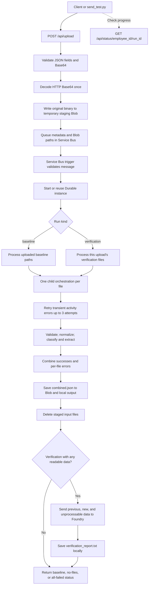

# End-to-End Flow: A Simple Walkthrough

This guide explains what happens from the moment a client sends a document until the verification report is saved.

Related guides: [API design](api-design.md) · [roles, security, and errors](roles-security-error-handling.md)

## At a glance

## Step 1: The client prepares an upload

The caller sends `employee_id`, `kind`, and one or more files to `POST /api/upload`. Each file provides a filename, Base64 text for its bytes, and an optional type hint (`auto`, `id`, `invoice`, or `ssc_memo`).

`send_test.py` walks the folder and Base64-encodes each supported file. It does not validate document content locally, so empty or corrupt files can reach the worker and receive a processing result.

## Step 2: The API validates the complete request

The API applies request-shape checks and stages the source file:

1. Pydantic checks employee ID, filename, extension, Base64 syntax, document type, and optional skip metadata.
2. The API decodes the HTTP Base64 once into the original file bytes.
3. It stores those bytes in `processing-staging` and queues only run metadata and blob paths.

The API does not inspect document content. Malformed request Base64 returns HTTP 400; a validly encoded but empty, unsupported, blank, or corrupt document is queued and handled by the worker.

For client-side skips, the API does not receive or store that file. It validates the skip error code and filename, then builds a safe message such as `Document contains no readable content.` for downstream reporting.

## Step 3: Source bytes are stored

The API uses one temporary staging container for both run kinds:

| Blob container | Purpose |
| --- | --- |
| `processing-staging` | Temporary source files for queued runs. The run kind remains in the queue message. |
| `results` | Combined extracted fields used for later baseline comparisons. |

Each temporary blob path is `{employee_id}/{doc_type}/{run_id}/{safe_file_name}`. The app stores original binary bytes, not Base64 text. Normalized OCR bytes are held in memory and not uploaded.

## Step 4: A queue message starts the background run

After storage, the endpoint puts a message on the `document-processing` Service Bus queue. The message includes:

- Employee ID, run ID, and kind.
- Blob paths for uploaded files.
- Optional `skipped_files` metadata from clients that still use it.

There are no document bytes or Base64 strings in the queue message. The endpoint returns HTTP 202 with the run ID; this means “queued,” not “report ready.”

The Service Bus trigger validates the message again. It uses `{employee_id}-{run_id}` as the Durable instance ID. If Service Bus redelivers a message for an existing instance, the duplicate is ignored.

## Step 5: The orchestrator chooses what to process

For a baseline run, the orchestrator processes the paths from that upload.

Both run kinds process only the paths in the current queue message. A verification run compares its newly extracted fields with the baseline fields saved in `results/{employee_id}/combined.json`; it does not need to reread baseline source documents.

If there are no files to process, the run returns `no_files_found` without calling Document Intelligence or Foundry.

## Step 6: Each file gets isolated processing and retries

The orchestrator creates one `process_file_with_retry` child orchestration per file. Each child calls the `process_file` activity and retries an unexpected/transient failure up to three attempts. Isolating the retries per file lets other files finish even when one file keeps failing.

After the retries are exhausted, that file becomes a failed result with `transient_service_error`. Permanent document errors return immediately with a specific code, such as `corrupt_image` or `blank_document`; they do not use transient retries.

The activity then:

1. Downloads the staged binary blob.
2. For a legacy `.txt` file, decodes its inner Base64 to get the actual PDF/image bytes.
3. Runs the shared content validator for size, signature, readability, encryption, and blank content.
4. Normalizes images in memory (orientation correction, resize, JPEG encoding). PDFs pass through unchanged.
5. Uses a folder hint, configured Document Intelligence classifier, or layout OCR keyword scoring to choose a document type/model.
6. Extracts fields or layout text/tables and returns an `ok` or failed result with the run ID.

Document Intelligence models used directly are `prebuilt-idDocument`, `prebuilt-invoice`, and `prebuilt-layout`.

## Step 7: Results are combined and saved

`combine_and_save` reads the prior combined JSON, combines the successful fields, and stores per-file errors with run ID, filename, code, and safe message.

For a verification upload:

- The verification section is refreshed from the current upload if at least one file succeeds.
- If every verification file fails, its previous good data is kept.
- If every processed file failed, the stored document sections are left untouched, errors are recorded, and the activity returns `all_failed: true`.

The combined data is saved to Blob Storage at `results/{employee_id}/combined.json` and locally under `LOCAL_OUTPUT_DIR`.

After the combined results are saved, a cleanup activity deletes the current run's staged input blobs. A lifecycle rule on `processing-staging` is a fallback for blobs left by runs that fail before cleanup. Lifecycle deletion is asynchronous, so it is not the primary cleanup mechanism.

## Step 8: Foundry compares readable data and explains skips

For verification runs with at least one processed file succeeding, the orchestrator calls Foundry. It passes:

- `employee_id`.
- `previous_documents` from the baseline section.
- `new_documents` from the verification section.
- `unprocessable_files`, combining pipeline failures and optional client-side skips.

The prompt tells the agent to report those files under `UNPROCESSABLE FILES` and not call them missing or mismatched. Each verification uses its own temporary Foundry conversation to prevent overlapping runs from sharing a conversation. The conversation is deleted after the response when cleanup succeeds.

The report is written to `{LOCAL_OUTPUT_DIR}/{employee_id}/verification_report.txt`. It is not uploaded to Blob Storage.

If every file processed by the pipeline fails, Foundry is skipped and the output status is `all_files_failed`. If some files fail but there is at least one processed success, Foundry runs and the status is `verification_report_saved_with_errors` with an error count and code summary.

## Step 9: The client checks status

Call `GET /api/status/{employee_id}/{run_id}` with the run ID returned by upload. The response contains:

- `state`: Durable Functions state such as `Running`, `Completed`, or `Failed`.
- `output`: Application result, including statuses such as `baseline_processed`, `verification_report_saved`, `verification_report_saved_with_errors`, `all_files_failed`, or `no_files_found`.

A completed Durable instance can still have an application status like `all_files_failed`; the runtime state and business result answer different questions.

## For more detail

- [API design and exact JSON contracts](api-design.md)
- [Roles, security boundaries, validation, and exceptions](roles-security-error-handling.md)
